<div align="center">

```
 ██████╗ ███╗   ███╗███╗   ██╗██╗
██╔═══██╗████╗ ████║████╗  ██║██║
██║   ██║██╔████╔██║██╔██╗ ██║██║
██║   ██║██║╚██╔╝██║██║╚██╗██║██║
╚██████╔╝██║ ╚═╝ ██║██║ ╚████║██║
 ╚═════╝ ╚═╝     ╚═╝╚═╝  ╚═══╝╚═╝
```

**One binary. One dashboard. Full-stack power.**

[](https://github.com/Manash07Bhoi/OmniCLI/actions/workflows/rust.yml)
[](https://github.com/Manash07Bhoi/OmniCLI/actions/workflows/typescript.yml)
[](https://github.com/Manash07Bhoi/OmniCLI/actions/workflows/security.yml)
[](https://github.com/Manash07Bhoi/OmniCLI/actions/workflows/ci.yml)
[](LICENSE)
[](https://crates.io/crates/omnicli-app)

*File ops · Full-text search · Format conversion · Archive management · Dev toolkit · Live web dashboard*

</div>

---

## What is OmniCLI?

OmniCLI is a **professional-grade, full-stack command-line toolkit** that replaces a scattered collection of utilities with a single, coherent binary — backed by a live React web dashboard and a typed REST API. Whether you're managing files on Android via Termux, running on Windows, doing security research on Kali Linux, writing automation scripts on ParrotOS, or running the live dashboard on Replit — `omni` speaks one grammar across every platform.

```bash
# Find every Rust file modified in the last 7 days
omnicli file find "*.rs" --modified 7d

# Hash a binary with BLAKE3 and pipe it
omnicli file hash firmware.bin --json | jq .digest

# Build the full-text index, then search it (20k files index in ~0.4 s;
# queries answer in single-digit milliseconds)
omnicli search index ~/projects ~/Documents
omnicli search "CVE-2026-1234"

# Convert an entire CSV dataset to JSON
omnicli convert run data.csv data.json

# Pack a directory into a compressed archive
omnicli archive create release.tar.gz ./dist

# Encrypt a file with age X25519 (recipient below is a throwaway example key —
# use the public half of your own key pair, e.g. from `age-keygen`)
omnicli file encrypt secrets.toml --recipient age15q67675v0dt4l36pnzkcf9qyaznvx54p7x7d9mqhh2flw27937wqlxgaux

# Open the dashboard (API on :8080, dashboard on :3000 by default)
open http://localhost:3000
```

---

## Project Components

| Component | Technology | Purpose |
|-----------|------------|---------|
| **Rust CLI** (`omnicli`) | Rust 1.88 · clap 4 · SQLite FTS5 | Core binary — all commands, all modules |
| **REST API** | Node.js · Express · TypeScript · Zod | Bridges CLI modules with the web layer |
| **Web Dashboard** | React 19 · Vite · Tailwind CSS 4 | Live telemetry, search, converter, dev toolkit |
| **Shared DB** | Drizzle ORM · SQLite | Notes, todos, snippets, activity log, backups |
| **OpenAPI Spec** | Orval · Zod · React Query | End-to-end typed client/server contract |

### Documentation index

| Document | Contents |
|----------|----------|
| [`docs/DEPLOYMENT.md`](docs/DEPLOYMENT.md) | Build outputs, configuration model (development/testing/staging/production), environment variables, supervision, data locations, deployment security |
| [`docs/SECURITY.md`](docs/SECURITY.md) | Reporting a vulnerability, what is in scope for the defensive security commands, built-in protections and the tests that cover them, dependency-audit results, known limitations |
| [`CHANGELOG.md`](CHANGELOG.md) | Version history, including which Phase-2 changes are unreleased |
| [`AUDIT_AND_FIX_REPORT.md`](docs/archive/AUDIT_AND_FIX_REPORT.md) | The Phase-1 audit that this work started from (historical evidence, not current documentation) |

---

## CLI Modules

| Module | Commands | Highlights |
|--------|----------|------------|
| **`omnicli file`** | find, copy, move, compare, duplicate, clean, hash, encrypt, decrypt, sync, stats | BLAKE3/SHA256/MD5 · age X25519 encryption · verified copy · BLAKE3-powered sync |
| **`omnicli search`** | index, query, info | SQLite FTS5 · Porter stemmer · regex · per-type filters · millisecond queries |
| **`omnicli archive`** | create, extract, list, convert | zip · tar.gz · tar.xz · tar.bz2 · magic-byte detection · zip-slip protected |
| **`omnicli convert`** | run, list | 16 format pairs: CSV↔JSON · YAML↔TOML↔JSON · MD→HTML · PNG/JPG↔WebP · PDF→TXT |
| **`omnicli config`** | show, path, read, get, set, validate | Full TOML config with validated defaults |

## Web Dashboard Panels

| Panel | What it does |
|-------|-------------|
| **Command Center** | Live telemetry — file counts, storage, module status and command surface read from the `omnicli` binary, activity log |
| **Global Search** | Search a directory tree (name or content, optional regex) and rebuild the FTS5 index |
| **File Finder** | Browse the filesystem and inspect file metadata |
| **Archive Inspector** | List and inspect archive contents without extracting |
| **Format Converter** | Convert files between 16 format pairs via drag-and-drop |
| **Dev Toolkit** | Hash, Base64, UUID generation, regex tester, JSON formatter, JWT decoder |
| **Workspace** | Notes, todos, and snippets — persisted in SQLite |
| **Backup Ops** | Incremental backup tracking with BLAKE3 deduplication |
| **Doctor & Report** | CLI: `omnicli doctor` checks the environment, config and data stores; `omni report` summarises them (terminal, JSON, Markdown) |
| **Security Audit** | CLI: `omnicli security permissions|secrets|config` — defensive checks for files and data you own |

---

## Design Principles

| Principle | What it means |
|-----------|---------------|
| **Zero mock data** | Every function returns data from a real operation. Unimplemented paths return an explicit `Err` — never a fake `Ok`. |
| **Typed errors everywhere** | Each crate owns a `CrateError` enum via `thiserror`. `anyhow` lives only at the dispatch boundary. |
| **BLAKE3 by default** | All content-hash operations use BLAKE3. SHA256 and MD5 available via `--algo`. |
| **Zip-slip protected** | Archive extraction validates all entry paths against `..` traversal and absolute-path injection. |
| **`--json` on every command** | Every command emits machine-readable JSON — no screen-scraping required. |
| **`--dry-run` on destructive ops** | `clean`, `sync --delete`, and `duplicate --delete-dupes` all support `--dry-run`; `duplicate --delete-dupes` also requires `--yes` or `--dry-run` before it removes anything. |
| **`NO_COLOR` respected** | Colour output honours the [no-color.org](https://no-color.org) standard and the `--no-color` flag. |

---


## Screenshots

Explore OmniCLI's capabilities through our full-stack interface.

### Web Dashboard

#### Dashboard
<p align="center">
  
  <br>
  <em>Real-time system telemetry, file counts, storage stats, and module status.</em>
</p>

#### Command Center
<p align="center">
  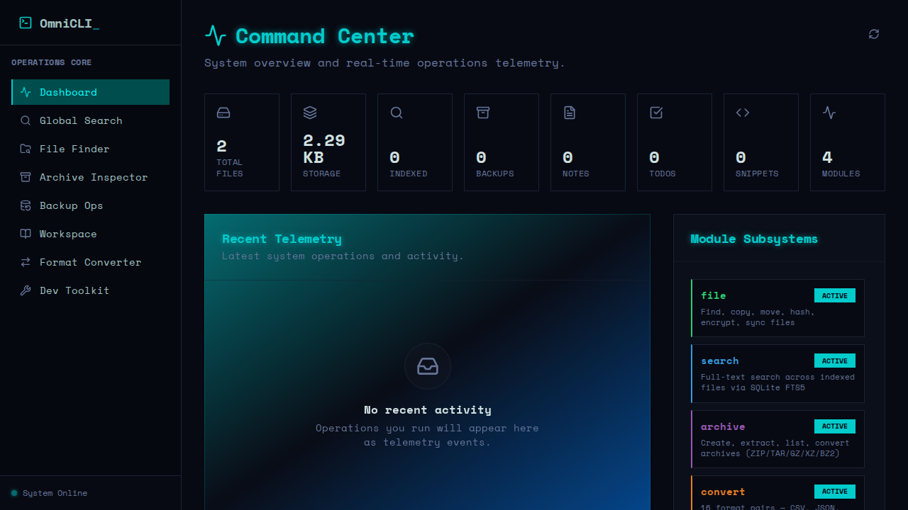
  <br>
  <em>Real-time system telemetry, file counts, storage stats, and module status in Dark Mode.</em>
</p>

#### Format Converter
<p align="center">
  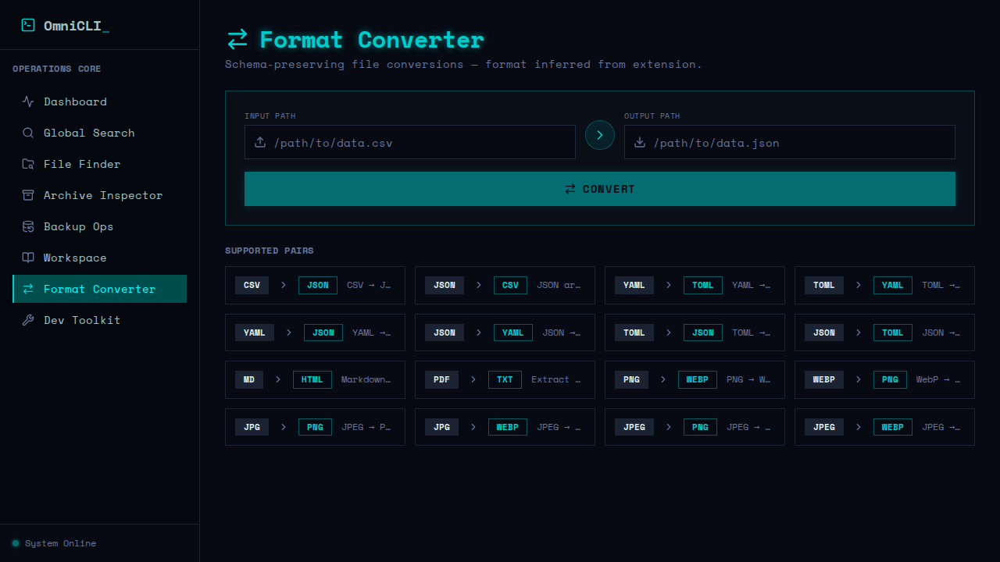
  <br>
  <em>Convert files between 16 format pairs by pointing at an input and an output path.</em>
</p>

### Core Features

#### File Operations
<p align="center">
  
  <br>
  <em>Browse the filesystem and inspect metadata effortlessly.</em>
</p>

#### Search & Find
<p align="center">
  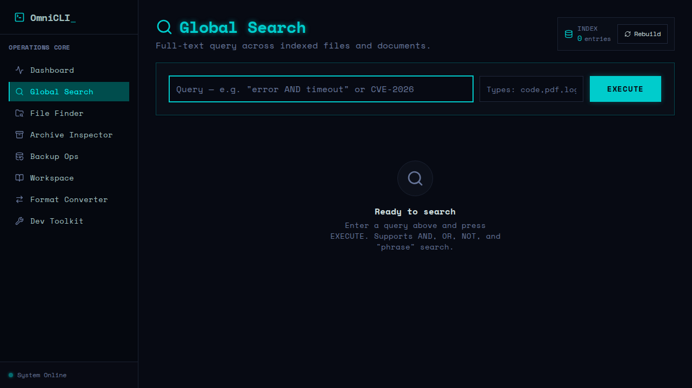
  <br>
  <em>Sub-second full-text queries across your indexed files using SQLite FTS5.</em>
</p>

#### Duplicate Finder
<p align="center">
  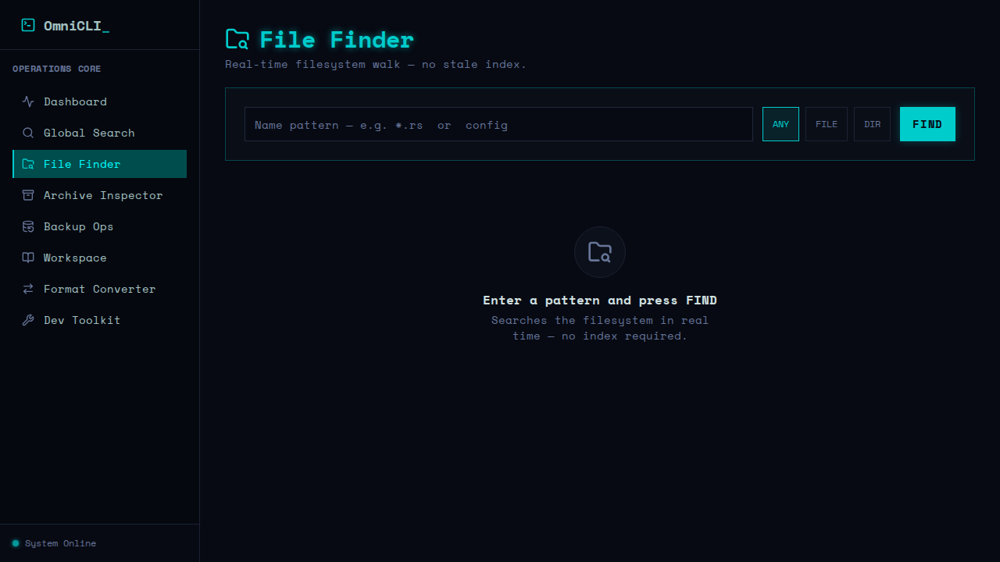
  <br>
  <em>Find and manage duplicate files quickly within the File Operations suite.</em>
</p>

#### Hash Generator
<p align="center">
  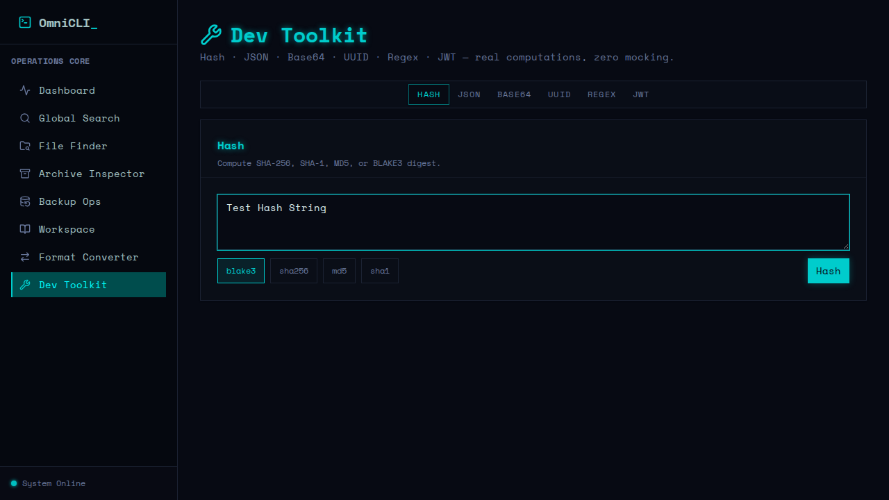
  <br>
  <em>Generate cryptographically secure hashes directly from the web dashboard.</em>
</p>

#### File Finder
<p align="center">
  
  <br>
  <em>Search the filesystem in real time and inspect file metadata.</em>
</p>

#### Sync & Backup
<p align="center">
  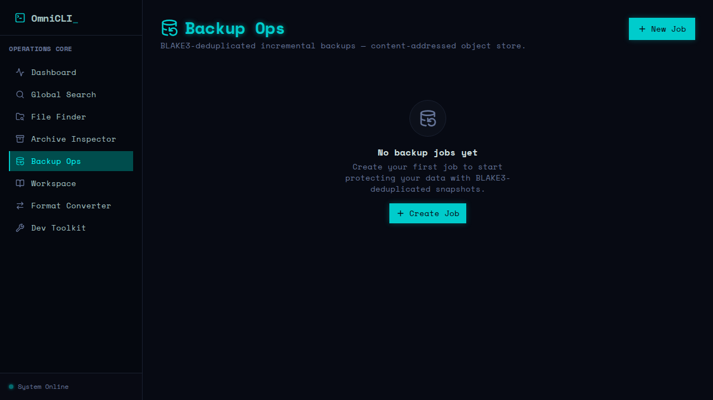
  <br>
  <em>Track incremental backups using BLAKE3 deduplication.</em>
</p>

#### Dev Toolkit
<p align="center">
  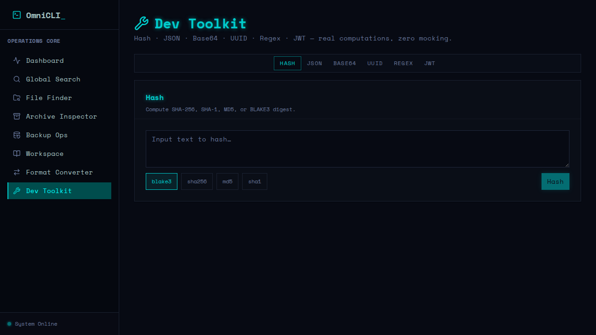
  <br>
  <em>Hash, Encode, UUID generation, regex testing, and JSON formatting.</em>
</p>

### Application Management

#### Workspace (notes, todos, snippets)
<p align="center">
  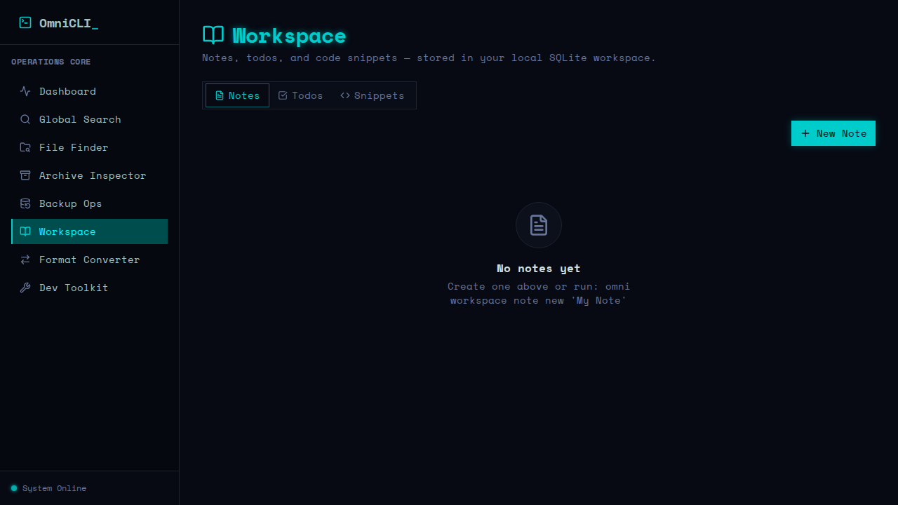
  <br>
  <em>Notes, todos and snippets backed by the workspace SQLite database.</em>
</p>

#### Archive Inspector
<p align="center">
  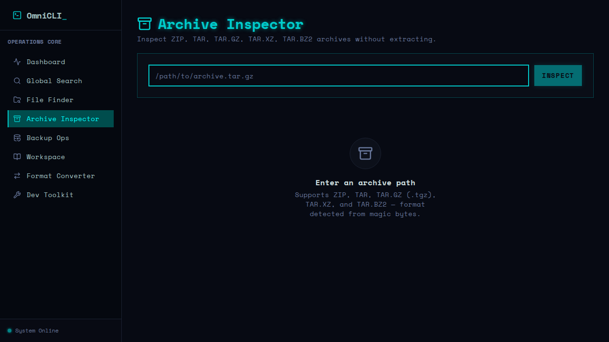
  <br>
  <em>List archive contents (zip, tar, tar.gz, tar.xz, tar.bz2) without extracting.</em>
</p>

### CLI Experience

#### Terminal Commands
<p align="center">
  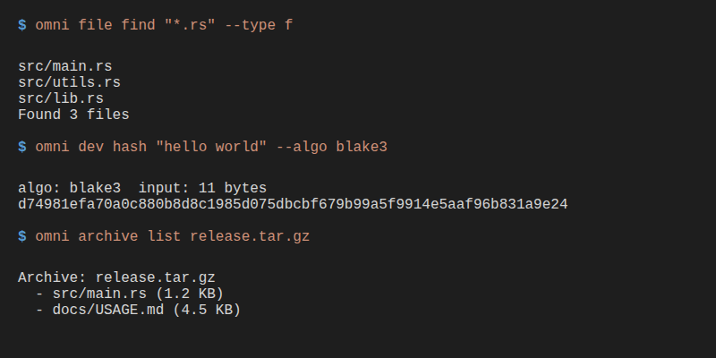
  <br>
  <em>Blazing fast file finding, hashing, and archive management.</em>
</p>
<p align="center">
  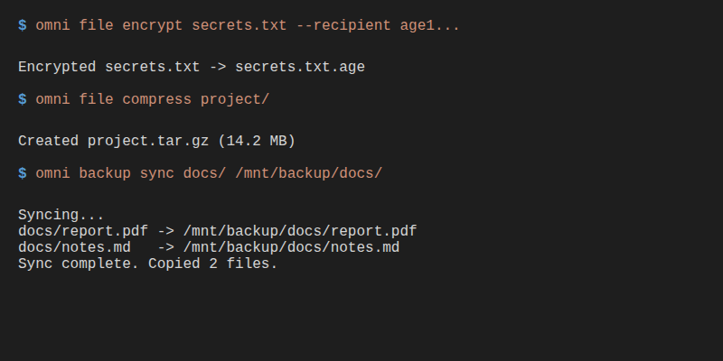
  <br>
  <em>Age X25519 encryption, compression, and syncing operations.</em>
</p>

### Mobile Experience

#### Responsive Command Center
<p align="center">
  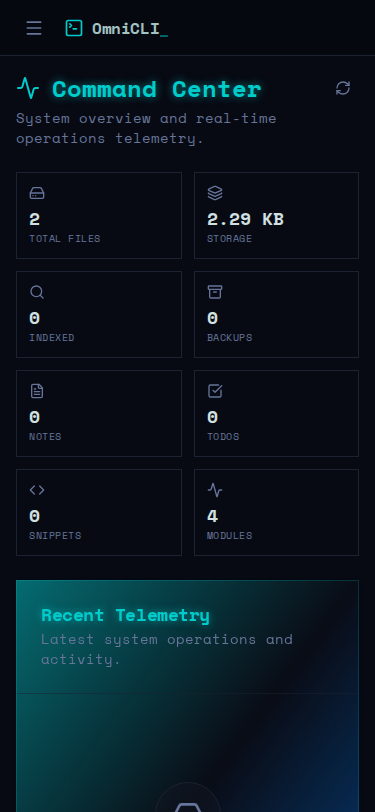
  <br>
  <em>Full-stack power accessible from your phone or Termux environment.</em>
</p>

---

## Releases

### How to Create a Release
Maintainers can create a new release simply by pushing a version tag to the repository —
the tag must equal the version in `omnicli/crates/omnicli-cli/Cargo.toml` (the workflow
enforces this and fails the release otherwise):
```bash
git tag v0.2.0
git push origin v0.2.0
```
This automatically triggers the GitHub Actions release workflow, which builds, packages, and publishes the release artifacts.

### Status of already-published releases
- **v1.0.0** — defective release page: it contains a stale 0.1.0-era binary and a
  malformed `SHA256SUMS.txt`. Treat it as deprecated; do not install from it.
- **v0.1.1** (currently marked "latest") — healthy, checksum-valid assets, but the
  binaries predate the current `main` (older search grammar, `_omni` completions
  name, and a SIGPIPE panic when output is piped to `head`).
- The next tagged release is the first produced end-to-end by the fixed, verified
  pipeline; prefer it (or a current source build) over both of the above.

### Where to Download
Users can download pre-compiled binaries from the [GitHub Releases](https://github.com/Manash07Bhoi/OmniCLI/releases) page.

### Officially Supported CI Platforms
`.github/workflows/release.yml` cross-compiles and publishes artifacts for seven targets:
- **Windows** (x86_64-pc-windows-msvc)
- **Linux** (x86_64-unknown-linux-gnu) — Debian, Ubuntu, Kali Linux, ParrotOS, etc.
- **Linux ARM64** (aarch64-unknown-linux-gnu) — Raspberry Pi, ARM servers
- **macOS** (x86_64 and aarch64)
- **Termux / Android** (aarch64-unknown-linux-musl, armv7-unknown-linux-musleabihf) — static binaries

All five Linux targets have been executed with the full test suite (x86_64 natively;
the three ARM/Termux triples under qemu emulation — see the
[platform support matrix](#platform-support-matrix) for what that does and does not
prove). Windows and macOS are build-verified in CI; their first runtime proof is the
first tagged build on the native runners.

### Verifying SHA-256 Checksums
Every release includes a `SHA256SUMS.txt` file containing checksums for all archives. To verify your downloaded archive, run the following command in the directory containing both the archive and the checksum file:

**Linux / macOS / Termux:**
```bash
sha256sum -c SHA256SUMS.txt --ignore-missing
```

**Windows (PowerShell):**
```powershell
$Expected = (Select-String -Path .\SHA256SUMS.txt -Pattern "omnicli-windows-x86_64.zip").Line.Split(" ")[0]
$Actual = (Get-FileHash .\omnicli-windows-x86_64.zip -Algorithm SHA256).Hash.ToLower()
if ($Expected -eq $Actual) { Write-Output "Checksum OK" } else { Write-Output "Checksum MISMATCH" }
```

---

## Installation

### Replit (zero setup)

All three services start automatically. After cloning:

```bash
pnpm install
# workflows start automatically — API on :8080, dashboard on the preview URL
# (the SQLite schema is created automatically the first time the API opens the database)
```

Build the Rust CLI:

```bash
cd omnicli && cargo build --release
./target/release/omnicli --help
```

### From source (recommended)
```bash
git clone https://github.com/Manash07Bhoi/OmniCLI
cd OmniCLI/omnicli && cargo build --release
./target/release/omnicli --version
```

> **crates.io:** the workspace is published as `omnicli-app` (binary `omnicli`)
> plus its library crates (`omnicli-core`, `omnicli-file`, `omnicli-search`,
> `omnicli-archive`, `omnicli-convert`, `omnicli-backup`, `omnicli-workspace`,
> `omnicli-dev`, `omnicli-config`), all at 0.1.1. **Note:** the published 0.1.1
> matches the `v0.1.1` GitHub release, not the newer unreleased commits on
> `main`. `cargo install omnicli-app` resolves and its manifest is valid
> (MIT, `[[bin]] omnicli`), but the first build compiles the full
> `age`/`i18n-embed` dependency tree and can take a while on small machines;
> for a fast install use a GitHub release (above) or build from source.

### Windows (PowerShell)

OmniCLI builds for Windows x86_64 and avoids Unix-only APIs (TTY detection uses `std::io::IsTerminal`, paths go through one `platform` module). You can install the CLI standalone, or run the full Web Dashboard suite. See the [platform support matrix](#platform-support-matrix): no Windows binary has been executed on the machine that produced this documentation, so Windows is build-verified rather than runtime-verified.

**System Requirements:**
- Windows 10 or Windows 11
- PowerShell 5.1 or later

#### 1. CLI Installation (Automated)

You can download and install the latest release directly via PowerShell:

```powershell
# Create an installation directory
New-Item -ItemType Directory -Force -Path $env:USERPROFILE\OmniCLI
Set-Location $env:USERPROFILE\OmniCLI

# Download the latest Windows release
Invoke-WebRequest -Uri "https://github.com/Manash07Bhoi/OmniCLI/releases/latest/download/omnicli-windows-x86_64.zip" -OutFile "omnicli.zip"

# Extract the archive
Expand-Archive -Path "omnicli.zip" -DestinationPath . -Force

# Add to your User PATH environment variable
$UserPath = [Environment]::GetEnvironmentVariable("PATH", "User")
if ($UserPath -notmatch "OmniCLI") {
    [Environment]::SetEnvironmentVariable("PATH", "$UserPath;$env:USERPROFILE\OmniCLI", "User")
}

# Verify installation (open a new PowerShell window first if omnicli is not found)
omnicli --version
```

#### 2. Web Dashboard Setup & Usage

The Web Dashboard provides a powerful local UI for file management, search, and viewing command history. Running it requires Node.js and `pnpm`.

**Prerequisites:** Ensure you have [Git](https://git-scm.com/download/win) and Node.js installed. If you have `winget`, you can install Node.js quickly:
```powershell
winget install OpenJS.NodeJS
npm install -g pnpm
```

**Clone and Start the Dashboard:**
```powershell
# 1. Clone the repository
git clone https://github.com/Manash07Bhoi/OmniCLI
cd OmniCLI

# 2. Install dependencies
pnpm install

# 3. Start the dashboard and REST API
#    (the SQLite schema is created automatically on first run)
pnpm run dev
```

*Open your web browser and navigate to **`http://localhost:3000`**!*

**Using the Web Dashboard:**
- **Command Center:** The default view at `localhost:3000` shows your system telemetry, total indexed files, and recent activity logs.
- **Global Search:** Click the "Search" tab on the sidebar. If you have indexed files via the CLI (`omnicli search index ~\Documents`), you can search their contents instantly here.
- **Format Converter:** Navigate to the Converter panel. Drag and drop a `data.csv` file from your desktop into the UI to instantly convert it to JSON or YAML.
- **Dev Toolkit:** Use the built-in UI tools to generate UUIDs, encode Base64 strings, or test Regex without dropping to the terminal.

### Termux (Android)

```bash
# 1. Install Rust, Git, and Node.js
pkg update && pkg install rust git nodejs

# 2. Clone and build the Rust CLI
git clone https://github.com/Manash07Bhoi/OmniCLI
cd OmniCLI
cd omnicli && cargo build --release
cp target/release/omnicli $PREFIX/bin/
omnicli --version

# 3. Start the Web Dashboard
cd ..
npm install -g pnpm
pnpm install

# Run the dashboard and API in development mode
# (the SQLite schema is created automatically on first run)
# It will start the API on port 8080 and the Dashboard on port 3000
pnpm run dev
```
*Open your mobile browser and navigate to `http://localhost:3000` to view the dashboard!*

### Kali Linux / ParrotOS / Debian

```bash
# 1. Install dependencies
sudo apt install build-essential libssl-dev pkg-config nodejs npm
curl --proto '=https' --tlsv1.2 -sSf https://sh.rustup.rs | sh
source $HOME/.cargo/env

# 2. Clone and build the Rust CLI
git clone https://github.com/Manash07Bhoi/OmniCLI
cd OmniCLI
cd omnicli && cargo build --release
sudo cp target/release/omnicli /usr/local/bin/
omnicli --version

# 3. Start the Web Dashboard
cd ..
sudo npm install -g pnpm
pnpm install

# Run the dashboard and API in development mode
# (the SQLite schema is created automatically on first run)
pnpm run dev
```
*Open a web browser and navigate to `http://localhost:3000` to view the dashboard!*

### Build from source

```bash
cd omnicli

# Debug build (fast compile, full symbols)
cargo build

# Optimised release binary (~12 MB, statically linked SQLite)
cargo build --release

# Run all tests
cargo test

# Lint (must stay clean)
cargo clippy -- -D warnings
```

---

## Global Flags

Every `omnicli` command accepts these flags at any position:

| Flag | Short | Description |
|------|-------|-------------|
| `--json` | | Structured JSON output — no ANSI codes, pipe-friendly |
| `--no-color` | | Disable colour (also honours `NO_COLOR` env var) |
| `--quiet` | `-q` | Suppress non-error output |
| `--verbose` | `-v` | Show debug traces to stderr |
| `--dry-run` | | Show plan without executing (destructive ops only) |
| `--config <PATH>` | | Override `~/.config/omni/omnicli.toml` |

---

## Command Reference

See **[docs/USAGE.md](omnicli/docs/USAGE.md)** for the complete practical reference with real examples and expected output.

### Windows Quick Examples (PowerShell)

```powershell
# ── Basics ────────────────────────────────────────────────────────────────────
omnicli --version
omnicli --help

# ── File ops ──────────────────────────────────────────────────────────────────
omnicli file find "*.rs" --modified 7d --type f
omnicli file hash firmware.bin --algo sha256 --json
omnicli file copy src\ dist\ --recursive --verify
omnicli file sync ~\source ~\backup --delete --dry-run
omnicli file duplicate ~\Downloads --delete-dupes --dry-run

# ── Search ────────────────────────────────────────────────────────────────────
omnicli search index ~\projects ~\Documents
omnicli search "CVE-2026-1234"
omnicli search query "TODO|FIXME" --in code --regex

# ── Archives ──────────────────────────────────────────────────────────────────
omnicli archive create release.zip src\ docs\
omnicli archive extract release.zip --to $env:TEMP\release
omnicli archive list release.zip --json
omnicli archive convert project.zip project.tar.gz

# ── Conversion ────────────────────────────────────────────────────────────────
omnicli convert run data.csv data.json
omnicli convert run config.yaml config.toml
omnicli convert run photo.png photo.webp

# ── Config ────────────────────────────────────────────────────────────────────
omnicli config show
omnicli config path
```


### Unix/Linux Quick examples

```bash
# ── File ops ──────────────────────────────────────────────────────────────────
omnicli file find "*.rs" --modified 7d --type f
omnicli file hash firmware.bin --algo sha256 --json | jq .digest
omnicli file copy src/ dist/ --recursive --verify
omnicli file sync ~/source ~/backup --delete --dry-run
omnicli file duplicate ~/Downloads --delete-dupes --dry-run

# ── Search ────────────────────────────────────────────────────────────────────
omnicli search index ~/projects ~/Documents
omnicli search "CVE-2026-1234"
omnicli search query "TODO|FIXME" --in code --regex

# ── Archives ──────────────────────────────────────────────────────────────────
omnicli archive create release.tar.gz src/ docs/
omnicli archive extract release.tar.gz --to /tmp/release
omnicli archive list release.tar.gz --json | jq '.[].name'
omnicli archive convert project.zip project.tar.gz

# ── Conversion ────────────────────────────────────────────────────────────────
omnicli convert run data.csv data.json
omnicli convert run config.yaml config.toml
omnicli convert run photo.png photo.webp
omnicli convert list

# ── Encryption ────────────────────────────────────────────────────────────────
age-keygen -o key.txt
omnicli file encrypt report.pdf --recipient age1ql3z7...
omnicli file decrypt report.pdf.age --identity AGE-SECRET-KEY-1...

# ── Config ────────────────────────────────────────────────────────────────────
omnicli config show
omnicli config show --json | jq .search.index_paths
omnicli config path
```

---

## API Server

Runs on `$PORT` (default 8080). All routes are under `/api`:

| Route | Method | Description |
|-------|--------|-------------|
| `/api/healthz` | GET | Health check — `{"status":"ok"}` |
| `/api/dashboard/stats` | GET | File counts, storage, module status |
| `/api/dashboard/activity` | GET | Recent operation log |
| `/api/dashboard/module-status` | GET | Live status of all active modules |
| `/api/files/*` | GET | File finder and metadata |
| `/api/search/query` | GET | Full-text search via SQLite FTS5 |
| `/api/convert/run` | POST | Run a format conversion |
| `/api/archive/list` | GET | List archive contents |
| `/api/workspace/*` | GET/POST | Notes, todos, snippets |
| `/api/backup/*` | GET/POST | Backup jobs |
| `/api/dev/*` | GET | Hash, UUID, Base64 dev toolkit |

The API contract is defined in [`lib/api-spec/openapi.yaml`](lib/api-spec/openapi.yaml) and enforced end-to-end via Zod schemas (generated by Orval).

---

## Architecture

```
OmniCLI/
├── omnicli/                            ← Rust workspace
│   ├── Cargo.toml                      ← Shared dependency versions (workspace deps)
│   └── crates/
│       ├── omnicli-cli/                ← Binary: clap parse → dispatch
│       ├── omnicli-core/               ← Shared: hashing, output, config, platform
│       ├── omnicli-file/               ← File operations (11 verbs)
│       ├── omnicli-search/             ← SQLite FTS5 index + query
│       ├── omnicli-archive/            ← zip/tar/* — zip-slip protected
│       ├── omnicli-convert/            ← 16 format codecs
│       ├── omnicli-backup/             ← Incremental, content-addressed backups
│       ├── omnicli-workspace/          ← Notes/todos/snippets store
│       ├── omnicli-dev/                ← Developer toolkit (hash, json, uuid, …)
│       └── omnicli-config/             ← Config loading (TOML)

│
├── artifacts/
│   ├── api-server/                     ← Express + TypeScript REST API
│   │   └── src/routes/                 ← health, dashboard, files, search, …
│   └── omni-dashboard/                 ← React 19 + Vite + Tailwind CSS 4
│
│   artifacts/mockup-sandbox/ is a Replit-only component preview server. It is
│   excluded from the pnpm workspace (see pnpm-workspace.yaml) because it is not
│   part of the product and its design-time dependency tree pulled in the only
│   advisory with no patched release. The source is kept in the repository.
│
└── lib/
    ├── api-spec/                       ← OpenAPI 3.1 specification
    ├── api-client-react/               ← Generated React Query hooks (Orval)
    ├── api-zod/                        ← Generated Zod schemas
    └── db/                             ← Drizzle ORM + SQLite schema
```

**Dependency rules (enforced by crate graph):**
- `omnicli-core` has zero module dependencies
- All other crates may depend on `omnicli-core` only
- `omnicli-file` may depend on `omnicli-archive` (compress delegates to it)
- `omnicli-cli` is the only crate that imports all modules

---

## Error Handling

```
Library crate    →  Result<T, CrateError>   (typed, via thiserror)
dispatch.rs      →  anyhow::Error            (human-readable, with context)
main.rs          →  exit(1) + stderr         (never silently swallows)
```

- Each crate defines its own `Error` enum — no stringly-typed errors in library code
- `unwrap()` and `expect()` are banned in library code (allowed only in tests)
- All errors include context: file path, operation, parameters

---

## Security

| Concern | Mitigation |
|---------|-----------|
| **Zip-slip** | Archive extraction rejects `..` path components and absolute entry paths |
| **Encryption** | age X25519 asymmetric encryption via the audited [`age`](https://crates.io/crates/age) crate |
| **Key exposure** | Identity keys in `--identity` are visible in `ps` — use shell substitution for production |
| **BLAKE3 integrity** | `--verify` on copy re-hashes the destination to confirm byte-identical transfer |
| **Dependency auditing** | `pnpm audit` is run in CI and is clean; `cargo audit`/`cargo deny` are wired into `.github/workflows/security.yml` and also runnable locally |
| **License gate** | `cargo deny` blocks GPL/AGPL/LGPL and the `openssl` crate (rustls only) |

---

## Testing

```bash
# Rust: 276 tests across 10 crates (unit + integration + black-box CLI)
cd omnicli && cargo test --workspace

# CLI black box: drives the compiled binary as a user would
cargo test -p omnicli-app --test cli

# API: 104 tests that boot the real HTTP server with the real CLI and SQLite
pnpm --filter @workspace/api-server test

# Installer: packages a release the way the release workflow does, serves it
# over HTTP, and runs the real install.sh through four scenarios
cd omnicli && ./scripts/test-installer.sh ./target/release/omnicli

# Rendered browser checks (a11y audit + e2e smoke). Playwright/axe are NOT
# package dependencies on purpose; install them in a scratch directory so the
# repo lockfile stays untouched:
mkdir -p /tmp/a11y-tools && cd /tmp/a11y-tools && npm init -y >/dev/null
npm install playwright @axe-core/playwright
npx playwright install chromium
export PLAYWRIGHT_BROWSERS_PATH="$HOME/.cache/ms-playwright"
ln -sfn /tmp/a11y-tools/node_modules /home/user/OmniCLI/artifacts/omni-dashboard/node_modules/a11y-tools
cd /home/user/OmniCLI/artifacts/omni-dashboard
node scripts/a11y-audit.mjs http://127.0.0.1:3000   # 9 pages, expect 0 problems
node scripts/e2e-smoke.mjs http://127.0.0.1:3000    # 15 checks, expect all pass

# Browser E2E smoke: the dashboard really shows what the API returns, every
# route reaches a loaded state, offline state appears and recovers, and the
# console stays clean (same browser prerequisites as the audit above)
node scripts/e2e-smoke.mjs http://127.0.0.1:3000
```

What the suites cover, and what they deliberately avoid:

- **Rust** — unit tests per module plus integration tests for encrypt→decrypt
  round trips, archive format round trips and CSV→JSON→YAML chains, and a
  black-box suite that runs the compiled binary and checks output, exit codes
  and JSON shapes.
- **API** — real HTTP requests against a real server that shells out to a real
  `omnicli` binary and a real SQLite workspace in a sandboxed `HOME`. Fixtures
  are written by the API and read back by an independent tool (Python), so a
  test cannot pass because two parts of the code share a wrong assumption.
- **Installer** — the actual download → checksum → extract → install path,
  including the three refusals that matter (bad checksum, missing checksum file,
  path-traversal member).
- **Accessibility** — axe-core over every route in a real browser, plus
  keyboard order, landmarks and the reduced-motion policy.

Nothing is mocked that can be run for real, and no test asserts a fabricated
result: where a component is unavailable the tests assert the honest failure
(503, 404, non-zero exit).

---

## Performance

Measured on the machine that produced this documentation — **2 vCPU Intel Xeon @ 2.60 GHz, 2 GB RAM, Linux x86_64**, release build (`cargo build --release`), best-of-5 runs. Numbers on your hardware will differ; the method is described so you can reproduce them.

| Operation | Corpus | Result |
|-----------|--------|--------|
| `omnicli search index` (fresh) | 20,000 text files (20,401 entries incl. directories) | **530–700 ms** (later runs 770–920 ms: every file is re-hashed) |
| `omnicli search index` size on disk | same corpus | 23–24 MB index for 20,000 documents |
| `omnicli search "needle"` (content hit, 20 matches) | same corpus | **22–26 ms** |
| `omnicli search query "needle" --regex` (content hit, 20 matches) | same corpus | 33 ms (a no-hit regex scans all 20,000 documents in ~60 ms) |
| `omnicli search "commonword"` (no matches) | same corpus | **6–8 ms** |
| `omnicli file find --count` | same corpus | 41 ms |
| `omnicli file hash --algo blake3` | 64 MB file | **19–27 ms** (≈2.4–3.4 GB/s) |
| `omnicli file hash --algo sha256` | 64 MB file | 50–69 ms |
| `omnicli file hash --algo md5` | 64 MB file | 134–146 ms |

Reproduce all of it with `omnicli/scripts/bench.sh` — it generates the same 20,000-file corpus (fixed random seed) and prints the timings above:

```bash
cd omnicli && cargo build --release
./scripts/bench.sh              # release binary + generated corpus
./scripts/bench.sh ./target/release/omnicli ~/my-corpus   # your own data
```

Design notes that explain the numbers:

- **BLAKE3** hashes ~2.5× faster than SHA-256 here (and ~6× faster than MD5) because the `blake3` crate uses SIMD where available.
- **Re-indexing is idempotent**: a file's content row is replaced, not appended, so repeated indexing neither duplicates search results nor grows the database.
- **Archive creation** streams through the encoder — no full in-memory buffer.
- **Sync** only copies changed files (BLAKE3 content comparison), making reruns cheap.
- **Duplicate scan** uses a two-pass strategy: size-group first, hash only size-collision candidates.

---

## Platform Support Matrix

| Target | CI build target | Runtime verified | Release artifact |
|--------|-----------------|------------------|------------------|
| **Linux x86_64** (Debian, Ubuntu, Kali, Parrot) | `x86_64-unknown-linux-gnu` | ✅ executed during this audit (`omnicli --version` → `0.1.1`, full test suite run) | `omnicli-linux-x86_64.tar.gz` |
| **Linux ARM64** (Raspberry Pi, ARM servers) | `aarch64-unknown-linux-gnu` | ✅ executed — full 276-test suite under qemu (emulated) | `omnicli-linux-aarch64.tar.gz` |
| **Termux / Android ARM64** (static musl) | `aarch64-unknown-linux-musl` | ✅ executed — full 276-test suite under qemu (emulated) | `omnicli-linux-aarch64-musl.tar.gz` |
| **Termux / Android ARMv7** (static musl) | `armv7-unknown-linux-musleabihf` | ✅ executed — full 276-test suite under qemu (emulated) | `omnicli-linux-armv7-musl.tar.gz` |
| **Windows x86_64** | `x86_64-pc-windows-msvc` | ⛔ not executed — build only | `omnicli-windows-x86_64.zip` |
| **macOS Intel** | `x86_64-apple-darwin` | ⛔ not executed — build only | `omnicli-macos-x86_64.tar.gz` |
| **macOS Apple Silicon** | `aarch64-apple-darwin` | ⛔ not executed — build only | `omnicli-macos-aarch64.tar.gz` |

**How to read this table.** "Build target" is what the release workflow compiles (`.github/workflows/release.yml`). "Runtime verified" is what has actually been *executed*: Linux x86_64 natively, and every ARM/Termux target under qemu user-mode emulation with the complete 276-test workspace suite (methodology and evidence: [`docs/release/PHASE3_RELEASE_CERTIFICATION.md`](docs/release/PHASE3_RELEASE_CERTIFICATION.md), §5 and §13). Emulated execution is labelled as such — it is not a claim of native hardware testing. No macOS or Windows binary has been executed yet; those targets are build-verified only until the first tagged release runs on the native CI runners, and issues reported by users on those platforms are treated as real bugs. The workflow re-verifies that the packaged binary reports the tag's version before publishing.

---

## Technical Notes

| Target | Architecture / Features |
|----------|-------|
| **Termux (Android)** | Static MUSL builds for aarch64 and armv7 (see the matrix for verification status). TTY detection uses `std::io::IsTerminal` — no `unsafe` blocks, no `libc` dependency. |
| **Windows** | Built for `x86_64-pc-windows-msvc`; TTY detection via `std::io::IsTerminal`. Use PowerShell for all provided scripts. |
| **Kali / ParrotOS** | Distributed as static binaries. `rusqlite` compiled with bundled SQLite to avoid system `libsqlite3` conflicts. |
| **Replit** | Uses `pnpm dev` workspace execution; SQLite DB initializes cleanly at `~/.local/share/omni/omni.db`. |
---

## Contributing

Read [CONTRIBUTING.md](omnicli/CONTRIBUTING.md) before opening a PR.

**Every PR must pass:**

```bash
cd omnicli
cargo clippy -- -D warnings   # zero diagnostics
cargo test                     # all tests green
cargo build --release          # release build succeeds
cargo fmt --check              # formatting clean
```

**Architecture rules:**
1. No function may return mock/hardcoded data — use `Err(...)` for unimplemented paths
2. No `unwrap()` / `expect()` in library code — propagate errors with `?`
3. Every new command must have `--json` output and a unit test
4. Clippy must stay clean (`-D warnings`)
5. Circular dependencies between crates are forbidden

---

## License

MIT — see [LICENSE](LICENSE).

---

<div align="center">

Built with ❤️ in Rust & TypeScript

Windows · Termux · Kali Linux · ParrotOS · Replit

[Usage Guide](omnicli/docs/USAGE.md) · [Contributing](omnicli/CONTRIBUTING.md) · [API Spec](lib/api-spec/openapi.yaml)

</div>
